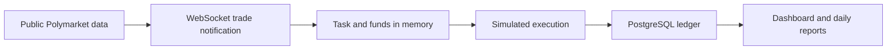

# WhaleFollow

**A self-hosted Polymarket copy trading simulator. Follow public traders, test position sizing, and keep an auditable paper ledger.**

[繁體中文](README.zh-Hant.md) · [Deployment](docs/deployment.md) · [Changelog](CHANGELOG.md) · [Contributing](CONTRIBUTING.md)

[](https://github.com/sonnno/WhaleFollow/actions/workflows/paper-ci.yml)
[](LICENSE)


WhaleFollow helps answer a practical question: **what happens when I follow this trader with my own bankroll and sizing rules?** Browse public leaderboards, create multiple follow tasks, and inspect copied orders, positions, fees, and realized profit in one dashboard.

This repository contains the **paper trading edition**. It does not place real orders and does not require a private key, seed phrase, trading API key, or wallet approval. The dashboard uses Chinese; project documentation is available in English and Traditional Chinese.

## Features

| Area | What you can do |
| --- | --- |
| Leaderboards | Browse supported official trader, biggest-win and builder leaderboards; filter periods/categories and paginate where supported. |
| Follow tasks | Follow multiple public wallet addresses; set a required copy percentage, total exposure budget and optional per-order cap. |
| Funds | Share a virtual wallet or assign a dedicated account to each trader, with manual transfers in and out. |
| Execution | Process complete WebSocket trade notifications directly, then persist simulated fills and ledger changes. |
| Order detail | Compare source/copied amounts, execution prices and times; inspect market type, outcome, line and official market link. |
| Accounting | Track remaining cash, unsettled investment, positions, fees, sales and final settlements. Filter records by followed trader. |
| Reports | Query paginated market results and fixed daily reports, including task breakdowns and available source-trader data. |
| Controls | Pause new buys globally or per task; show balance warnings triggered by insufficient-funds attempts. |

Tasks share one Worker and market subscriptions to limit resource usage. Dedicated accounts keep their own cash, positions and profit records; they do not receive automatic top-ups from the shared wallet.

## Quick start

Prerequisites: Git, Docker Engine and the Docker Compose plugin. A Debian host with **2 vCPUs / 2 GB RAM** is a starting point for one small deployment; monitor usage as tasks and history grow. You do not need to install Node.js, PostgreSQL or Redis on the host.

```bash
git clone https://github.com/sonnno/WhaleFollow.git
cd WhaleFollow
docker compose up -d
```

The first run builds the image, creates persistent credentials, starts PostgreSQL and Redis, applies database migrations, and starts the API and Worker. The default virtual bankroll is **350**, with **no follow tasks started automatically**.

Open `http://localhost:3000` or your server's port 3000. Retrieve the generated login:

```bash
docker compose exec api node deploy/show-login.js
```

The default username is `admin`; the password is generated on first boot and retained across restarts. Restrict access to the dashboard and use HTTPS when exposing it beyond a trusted network. PostgreSQL and Redis are not published on host ports.

Then:

1. Open **排行榜** (Leaderboards), select a trader, or paste a public wallet address in **跟單任務** (Follow tasks).
2. Choose shared or dedicated funds. For a dedicated account, enter an initial transfer amount.
3. Set the copy percentage. **100% means the same source trade amount, not 100% of your wallet.**
4. Choose **儲存並開始跟單** (Save and start). Saving without starting leaves the task paused.
5. Inspect the overview, order details and daily reports as new public trades arrive.

## Accounting you can inspect

- **Realized profit** comes from copied sales and final settlements, including the corresponding simulated trading fees. Unsettled price movements are excluded.
- **Unsettled investment** is remaining position cost, including entry fees. It is not cash and is not guaranteed settlement proceeds.
- **Daily close:** at **10:00 Asia/Shanghai (UTC+8)**, the Worker records the previous calendar day, from 00:00 to 24:00. For example, October 14 is published on October 15 at 10:00. The overview reads these saved reports; it does not label today's running total as a completed day.
- Reports include total and per-task results. Public source-trader figures remain marked unavailable when the upstream data cannot establish them; they are not replaced with invented zeroes.
- Dedicated-account transfers move internal paper funds. Changing an exposure budget does not transfer cash, and profits stay in the dedicated account until manually transferred out.

## Execution behavior



Complete trade notifications do not wait for a source-trade REST lookup before simulated execution. A failed attempt is retried immediately, with at most three failed attempts total. Insufficient funds trigger a wallet warning without creating an order. Restarting or resuming does **not** backfill missed buy orders. Existing positions continue through copied sales and settlement while new buys are paused.

Paper results are a model, not a live-execution guarantee. Public-feed delay, order-book changes, liquidity, fees and real matching can change outcomes. Source timestamps may only have second precision, so displayed time differences are not precise network benchmarks. There is no promised return and no affiliation with Polymarket.

## Operations

```bash
# Inspect services and recent logs
docker compose ps -a
docker compose logs --tail=100 api worker
docker stats --no-stream

# Stop while retaining data
docker compose down

# Start again with existing data and credentials
docker compose up -d
```

To update, stop services before migrations:

```bash
docker compose down
git pull --ff-only
docker compose up -d --build
```

**Do not use `docker compose down -v` unless you intend to delete persistent data.** Back up both the database and runtime credentials. See the [deployment guide](docs/deployment.md) for configuration, backups, port changes and troubleshooting.

## Development

Stack: **Node.js 24 · async callbacks · TypeORM · PostgreSQL 16 · Redis 7 · React 19 · Vite 6**.

```bash
cd paper
npm ci
npm test
npm run check
npm run web:build
```

Business logic lives in services and uses `async.waterfall` / error-first callbacks. The TypeORM adapter handles its Promise-based boundary. CI also exercises fresh Compose boot, isolated financial SQL checks and persistent restart.

Contributions are welcome: reproducible bug reports, accounting tests, deployment improvements and UI translations. Read [CONTRIBUTING.md](CONTRIBUTING.md); report sensitive issues through [SECURITY.md](SECURITY.md).

## License

[MIT](LICENSE) · Copyright © 2026 sonnno.
