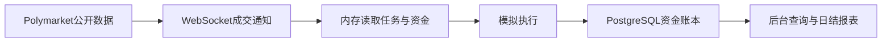

# 随鲸 WhaleFollow

**可自行部署的 Polymarket 虚拟跟单系统：观察公开交易员，用自己的本金和比例模拟跟单，逐笔核对资金与盈亏。**

[English](README.md) · [部署说明](docs/deployment.zh-CN.md) · [更新记录](CHANGELOG.md) · [参与贡献](CONTRIBUTING.md)

[](https://github.com/sonnno/WhaleFollow/actions/workflows/paper-ci.yml)
[](LICENSE)


跟单不只是复制一笔买入，还要知道：跟了谁、按什么比例、用了多少资金、付了多少费用、最终赚亏多少。WhaleFollow 把这些记录放进同一个可查询的后台，方便比较交易员和资金配置。

本仓库发布 **paper 虚拟跟单版**，不发送真钱订单，不需要私钥、助记词、交易 API 密钥或钱包授权。目前后台界面为简体中文，项目文档提供中英文版本。

## 主要功能

| 功能 | 说明 |
| --- | --- |
| 排行榜查询 | 查询支持的官方交易员、大额盈利及建设者榜单，按接口能力选择周期、分类、排序和分页。 |
| 多人跟单 | 每人独立配置跟单比例、总投入上限及可选的单笔上限。 |
| 资金管理 | 公共钱包或独立跟单账户，支持首次转入和后续手动转入、转出。 |
| 实时虚拟成交 | 完整 WebSocket 成交通知直接进入执行流程，随后记录账本。 |
| 订单详情 | 显示市场类型、玩法、盘口、方向、官网链接，以及原主和我们的金额、价格、成交时间和时间差。 |
| 盈亏与持仓 | 查询剩余现金、未结算投入、合并持仓、费用、卖出和最终结算；支持按跟单人筛选。 |
| 统计与日表 | 市场统计筛选分页；每日固定日结，保存总账、各任务及可取得的原主公开数据。 |
| 启停与预警 | 全局或单任务暂停新买入，余额不足时在首页显示对应账户预警。 |

多人共用一个 Worker 和市场订阅，减少重复连接。独立账户的钱只给该任务使用，不会从公共钱包自动补款。

## 三条命令启动

需要 Git、Docker Engine 和 Docker Compose 插件。Debian 上单套小规模部署可从 **2核 / 2GB内存** 起步，后续按任务和历史数据量监测资源。宿主机不需要另装 Node.js、PostgreSQL 或 Redis。

```bash
git clone https://github.com/sonnno/WhaleFollow.git
cd WhaleFollow
docker compose up -d
```

首次运行会构建镜像、生成持久化凭据、启动 PostgreSQL 和 Redis、执行数据库迁移，再启动后台和 Worker。默认虚拟本金 **350**，**不会自动开始任何跟单任务**。

访问 `http://localhost:3000` 或服务器的3000端口，查看首次生成的登录信息：

```bash
docker compose exec api node deploy/show-login.js
```

默认用户名 `admin`，密码随机生成并保留，重启不会更换。公网使用时应限制访问来源并配置 HTTPS；数据库和 Redis 不对外映射端口。

首次使用：

1. 在“排行榜”选择交易员，或在“跟单任务”填写公开钱包地址。
2. 选择公共钱包或独立账户；独立账户可同时填写首次转入金额。
3. 填写跟单比例。**100%表示原主每笔成交金额的100%，不是把钱包全部押上。**
4. 点击“保存并开始跟单”；只点“保存设置”不会开始买入。
5. 在总览、跟单明细、持仓、结算记录和日表中查看结果。

## 资金和日结口径

- **总盈亏**：已卖出及最终结算产生的实际模拟盈亏，计入对应交易手续费，不包含未结算浮盈。
- **未结算投入**：剩余持仓成本，含买入费用；不等于现金，也不等于将来必定拿回的钱。
- **每天北京时间10点日结**：统计前一天00:00至24:00。例如14日的日报在15日10点生成。总览每日盈亏读取固定日表，不把当天实时累计当成已完成日报。
- **日表保存**：包含总账、各跟单任务的结果。原主公开数据不足时标记未取得，不以0冒充真实盈亏。
- **独立账户**：划转只是虚拟账本内部资金分配。调整投入上限不会自动划款；盈利留在独立账户，手动转出才回到公共钱包。

## 跟单执行规则



收到完整成交通知后，不先查询原主 REST 成交记录才执行。失败立即重试，累计最多3次失败；余额不足不生成订单，只触发账户预警。重启或重新开始跟单，**不会补买期间错过的历史订单**。暂停新买入时，已有持仓继续跟随卖出与结算。

模拟结果不能保证真钱交易能复现：公开数据推送、盘口变化、流动性、费用和真实撮合都可能影响结果。原主时间可能只精确到秒，页面时间差不能当作精密网络测速。本项目不承诺收益，与 Polymarket 无隶属关系。

## 日常运维

```bash
docker compose ps -a
docker compose logs --tail=100 api worker
docker stats --no-stream

# 停止，保留数据
docker compose down

# 沿用原有数据和凭据启动
docker compose up -d
```

升级前停止服务，避免旧进程占用迁移锁：

```bash
docker compose down
git pull --ff-only
docker compose up -d --build
```

**不要随意使用 `docker compose down -v`，它会删除持久化数据。** 数据库和 runtime 凭据都要备份。端口、初始本金、凭据、备份和故障排查见[完整部署说明](docs/deployment.zh-CN.md)。

## 开发与贡献

技术栈：**Node.js 24 · async回调 · TypeORM · PostgreSQL 16 · Redis 7 · React 19 · Vite 6**。

```bash
cd paper
npm ci
npm test
npm run check
npm run web:build
```

业务逻辑放在 service，使用 `async.waterfall` 和 error-first callback；TypeORM 的 Promise 接口封装在数据库适配层。CI 同时验证 Docker 首次启动、隔离财务 SQL 和重启后数据保留。

欢迎提交可复现的问题、账务测试、部署改进和界面翻译。参与方式见 [CONTRIBUTING.md](CONTRIBUTING.md)，敏感问题见 [SECURITY.md](SECURITY.md)。

## 许可证

[MIT](LICENSE) · Copyright © 2026 sonnno。
