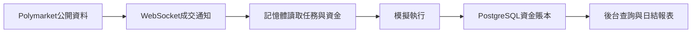

# 隨鯨 WhaleFollow

**可自行部署的 Polymarket 虛擬跟單系統：觀察公開交易員，用自己的本金和比例模擬跟單，逐筆核對資金與盈虧。**

[English](README.md) · [部署說明](docs/deployment.zh-Hant.md) · [更新記錄](CHANGELOG.md) · [參與貢獻](CONTRIBUTING.md)

[](https://github.com/sonnno/WhaleFollow/actions/workflows/paper-ci.yml)
[](LICENSE)


跟單不只是複製一筆買入，還要知道：跟了誰、按什麼比例、用了多少資金、付了多少費用、最終盈虧多少。WhaleFollow 把這些記錄放進同一個可查詢的後台，方便比較交易員和資金設定。

本倉庫釋出 **paper 虛擬跟單版**，不傳送真錢訂單，不需要私鑰、助記詞、交易 API 金鑰或錢包授權。後台介面與文件均提供 **繁體中文及英文**。登入頁與 **系統設定 → 介面語言** 可透過國旗和語言名稱切換，立即生效並記住目前瀏覽器的選擇。

## 主要功能

| 功能 | 說明 |
| --- | --- |
| 排行榜查詢 | 查詢支援的官方交易員、大額盈利及建設者榜單，按介面能力選擇週期、分類、排序和分頁。 |
| 多人跟單 | 每人獨立設定跟單比例、總投入上限及可選的單筆上限。 |
| 資金管理 | 公共錢包或獨立跟單賬戶，支援首次轉入和後續手動轉入、轉出。 |
| 即時虛擬成交 | 完整 WebSocket 成交通知直接進入執行流程，隨後記錄賬本。 |
| 訂單詳情 | 顯示市場型別、玩法、盤口、方向、官網連結，以及原主和我們的金額、價格、成交時間和時間差。 |
| 盈虧與持倉 | 查詢剩餘現金、未結算投入、合併持倉、費用、賣出和最終結算；支援按跟單人篩選。 |
| 統計與日表 | 市場統計篩選分頁；每日固定日結，儲存總賬、各任務及可取得的原主公開資料。 |
| 啟停與預警 | 全域性或單任務暫停新買入，餘額不足時在首頁顯示對應賬戶預警。 |

多人共用一個 Worker 和市場訂閱，減少重複連線。獨立賬戶的錢只給該任務使用，不會從公共錢包自動補款。

## 三條命令啟動

需要 Git、Docker Engine 和 Docker Compose 外掛。Debian 上單套小規模部署可從 **2核 / 2GB記憶體** 起步，後續按任務和歷史資料量監測資源。宿主機不需要另裝 Node.js、PostgreSQL 或 Redis。

```bash
git clone https://github.com/sonnno/WhaleFollow.git
cd WhaleFollow
docker compose up -d
```

首次執行會建置映象、生成持久化憑據、啟動 PostgreSQL 和 Redis、執行資料庫遷移，再啟動後台和 Worker。預設虛擬本金 **350**，**不會自動開始任何跟單任務**。

訪問 `http://localhost:3000` 或伺服器的3000埠，檢視首次生成的登入資訊：

```bash
docker compose exec api node deploy/show-login.js
```

預設使用者名稱 `admin`，密碼隨機生成並保留，重啟不會更換。公網使用時應限制訪問來源並設定 HTTPS；資料庫和 Redis 不對外對映埠。

首次使用：

1. 在“排行榜”選擇交易員，或在“跟單任務”填寫公開錢包地址。
2. 選擇公共錢包或獨立賬戶；獨立賬戶可同時填寫首次轉入金額。
3. 填寫跟單比例。**100%表示原主每筆成交金額的100%，不是把錢包全部押上。**
4. 點選“儲存並開始跟單”；只點“儲存設定”不會開始買入。
5. 在總覽、跟單明細、持倉、結算記錄和日表中檢視結果。

## 資金和日結口徑

- **總盈虧**：已賣出及最終結算產生的實際模擬盈虧，計入對應交易手續費，不包含未結算浮盈。
- **未結算投入**：剩餘持倉成本，含買入費用；不等於現金，也不等於將來必定拿回的錢。
- **每天北京時間10點日結**：統計前一天00:00至24:00。例如14日的日報在15日10點生成。總覽每日盈虧讀取固定日表，不把當天即時累計當成已完成日報。
- **日表儲存**：包含總賬、各跟單任務的結果。原主公開資料不足時標記未取得，不以0冒充真實盈虧。
- **獨立賬戶**：劃轉只是虛擬賬本內部資金分配。調整投入上限不會自動劃款；盈利留在獨立賬戶，手動轉出才回到公共錢包。

## 跟單執行規則



收到完整成交通知後，不先查詢原主 REST 成交記錄才執行。失敗立即重試，累計最多3次失敗；餘額不足不生成訂單，只觸發賬戶預警。重啟或重新開始跟單，**不會補買期間錯過的歷史訂單**。暫停新買入時，已有持倉繼續跟隨賣出與結算。

模擬結果不能保證真錢交易能復現：公開資料推送、盤口變化、流動性、費用和真實撮合都可能影響結果。原主時間可能只精確到秒，頁面時間差不能當作精密網路測速。本專案不承諾收益，與 Polymarket 無隸屬關係。

## 日常運維

```bash
docker compose ps -a
docker compose logs --tail=100 api worker
docker stats --no-stream

# 停止，保留資料
docker compose down

# 沿用原有資料和憑據啟動
docker compose up -d
```

升級前停止服務，避免舊程序佔用遷移鎖：

```bash
docker compose down
git pull --ff-only
docker compose up -d --build
```

**不要隨意使用 `docker compose down -v`，它會刪除持久化資料。** 資料庫和 runtime 憑據都要備份。埠、初始本金、憑據、備份和故障排查見[完整部署說明](docs/deployment.zh-Hant.md)。

## 開發與貢獻

技術棧：**Node.js 24 · async回撥 · TypeORM · PostgreSQL 16 · Redis 7 · React 19 · Vite 6**。

```bash
cd paper
npm ci
npm test
npm run check
npm run web:build
```

業務邏輯放在 service，使用 `async.waterfall` 和 error-first callback；TypeORM 的 Promise 介面封裝在資料庫適配層。CI 同時驗證 Docker 首次啟動、隔離財務 SQL 和重啟後資料保留。

歡迎提交可復現的問題、賬務測試、部署改進和介面翻譯。參與方式見 [CONTRIBUTING.md](CONTRIBUTING.md)，敏感問題見 [SECURITY.md](SECURITY.md)。

## 授權條款

[MIT](LICENSE) · Copyright © 2026 sonnno。
